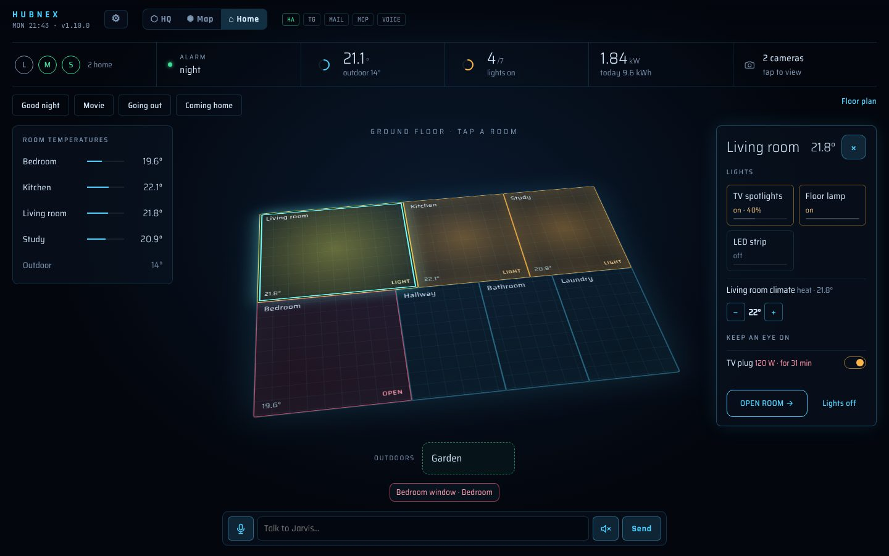

# HubNEX

*[English](README.md) · [Italiano](README.it.md) · Nederlands*

**Het AI-hoofdkwartier voor thuis en werk**, als add-on voor Home Assistant.

> Dit is een **Nederlandse fork** van [P1pp89/HubNEX](https://github.com/P1pp89/HubNEX) (MIT-licentie).
> Het originele project is Italiaans en Engels; deze fork voegt het Nederlands toe (dashboard, meldingen,
> Telegram, spraak, Assist-integratie en voorbeeldteam) en wat beveiligingsverbeteringen. Het
> oorspronkelijke auteursrecht blijft bij de maker, zie [LICENSE](LICENSE).



Een assistent (standaard Jarvis genoemd) coördineert een team van AI-agents (Claude), elk met een
eigen rol: mail, administratie, technisch onderzoek, huis, beveiliging… Je praat ermee via het
3D-dashboard in de zijbalk van Home Assistant, via een Telegram-groep of met je stem via Assist.

- **3D-dashboard**: het hoofdkwartier met de agents aan het werk, de neurale kaart van wat het team
  weet en de geanimeerde kern die luistert, nadenkt en spreekt.
- **Weergave Thuis**: het dashboard van Home Assistant op de holografische plattegrond van je huis,
  met kamers, lampen, klimaat, rolluiken, live camera's, alarm en een energiepaneel. Directe
  opdrachten in real time, zonder AI-kosten.
- **Instelbaar team** in `agents.yaml`: bedrijven, afdelingen, agents, instructies, routines.
- **MCP-connectors**: koppel de programma's van je werk (boekhouding, agenda's, CRM…). Agents
  lezen vrij; elke wijziging wordt pas uitgevoerd na jouw ✅.
- **E-mail**: je mail sorteren en conceptantwoorden die jij goedkeurt.
- **Telegram**: een groep met een bot voor de assistent en een voor de mail, inclusief spraakberichten, foto's en documenten.
- **Spraak**: Assist van Home Assistant (ook lokaal met Piper), ElevenLabs of de spraaksynthese van
  Home Assistant in het dashboard.
- **Geen eigen initiatief zonder jouw opdracht**: routines staan standaard uit, er wordt niets in
  huis gedaan zonder dat je erom vraagt, en vaste regels gelden voor het hele team.
- **Italiaans, Engels en Nederlands**: het dashboard volgt de taal van Home Assistant van elke
  gebruiker; de assistent en de add-on volgen de optie **Taal**.

## Installatie

1. Home Assistant → Instellingen → Add-ons → **Add-on store** → ⋮ → **Repositories** → voeg
   `https://github.com/NicoLPHA/HubNEX` toe.
2. Installeer **HubNEX**, open **Configuratie**, vul de Anthropic API-sleutel in, kies bij **Taal**
   eventueel `nl`, klik op **Start** en zet **Toon in zijbalk** aan.

De add-on wordt bij de installatie **lokaal gebouwd** uit de code van deze repository (er wordt geen
kant-en-klare image van iemand anders gedownload). De eerste installatie duurt daardoor een paar
minuten langer.

De volledige handleiding (team, connectors, spraak, Telegram, mail, weergave Thuis) staat in
[`hubnex/DOCS.nl.md`](hubnex/DOCS.nl.md).

Je hebt een Anthropic-account met tegoed nodig: HubNEX gebruikt Claude Sonnet voor de assistent en
de agents en Claude Haiku voor mail en snelle opdrachten. De opdrachten van de weergave Thuis en,
met Assist, de eenvoudige opdrachten van Home Assistant gebruiken geen tegoed.

> **Privacy:** alles wat je tegen de assistent zegt of typt, en de toestand van de huisapparaten die
> hij nodig heeft, gaat naar de Anthropic API. Mail, Telegram en spraak (ElevenLabs) gebruiken
> daarnaast hun eigen diensten. Zie [`SECURITY.md`](SECURITY.md) en de aanbevelingen in de handleiding.

## Zonder Home Assistant (Docker)

```bash
cd hubnex
cp .env.example .env        # vul de sleutels in
docker compose up -d --build
# dashboard: http://<ip-van-de-machine>:8765/?token=<HQ_TOKEN>
```

## API

Alle aanroepen hebben `Authorization: Bearer <HQ_TOKEN>` nodig (of `?token=`).

| Methode | Pad | |
|---|---|---|
| GET | `/api/state` | Volledige toestand (team, activiteit, deadlines, statistieken) |
| POST | `/api/chat` | `{"text": "...", "attachments": []}` → het antwoord van de assistent |
| POST | `/api/attachments?name=` | Een foto, pdf of tekstbestand (ruwe body) → `{"id"}` voor `attachments` |
| POST | `/api/agents/{id}/task` | `{"task": "...", "wait": false}` wijst een taak toe |
| POST | `/api/deadlines` | `{"title", "due", "notes"}` |
| POST | `/api/tts` | `{"text"}` → audio in de ingestelde stem |
| POST | `/api/ha/event` | Gebeurtenis vanuit een automatisering van Home Assistant |
| GET | `/api/casa` | Weergave Thuis: plattegrond, gebieden, entiteiten en toestanden |
| GET | `/api/backup` | Back-up van alles wat HubNEX weet (zip) |
| WS | `/ws?token=` | Live stroom voor het dashboard |

Stuur `X-HubNEX-Lang: nl` om foutmeldingen in het Nederlands te krijgen.

## Ontwikkeling

Zie [CONTRIBUTING.md](CONTRIBUTING.md): een demo met een nagebootst huis en een nagebootste Claude
(`python hubnex/dev/demo.py 8765`), de servertests (`pytest`) en de browsertests van het
dashboard. De tests gebruiken een nepclient voor Claude: geen echte aanroepen en geen kosten.

Nieuwe teksten vertalen: de Italiaanse tekst in de code is de sleutel. De Nederlandse vertalingen
staan in `hubnex/hubnex/i18n_nl.py` (add-on) en `hubnex/web/i18n-nl.js` (dashboard). Wat ontbreekt
zie je met `python hubnex/dev/i18n_keys.py --missing --lang nl` (dashboard) en met `--python`
erbij (add-on); de tests controleren dat er niets ontbreekt.

Structuur: `hubnex/hq.py` (het team, de toestand, delegeren), `hubnex/llm.py` (Claude-agentlus),
`hubnex/connectors.py` en `hubnex/integrations/mcp.py` (MCP-connectors), `hubnex/actions.py` (acties
ter bevestiging), `hubnex/casa.py` en `hubnex/energy.py` (weergave Thuis), `hubnex/maildesk.py`
(e-mail), `hubnex/i18n.py` (talen), `hubnex/tools/` (de tools van de agents), `hubnex/integrations/`
(Home Assistant, Telegram, IMAP/SMTP, ElevenLabs), `web/` (dashboard: Three.js en hls.js
inbegrepen, werkt ook zonder internet).

## Het originele project steunen

HubNEX is gratis en open source, gemaakt door [P1pp89](https://github.com/P1pp89/HubNEX). Wie het
origineel wil steunen, kan dat via zijn
**[PayPal-pagina](https://www.paypal.com/donate/?hosted_button_id=HTZJULXKFP8M4)**, of met een ster op GitHub.

## Licentie

[MIT](LICENSE). Bevat [Three.js](https://threejs.org) (MIT) en
[hls.js](https://github.com/video-dev/hls.js) (Apache 2.0): zie [NOTICE](NOTICE).

HubNEX is niet verbonden aan Anthropic, Home Assistant, ElevenLabs of Marvel: "Jarvis" is alleen de
standaardnaam van de assistent en kan in `agents.yaml` worden gewijzigd.
